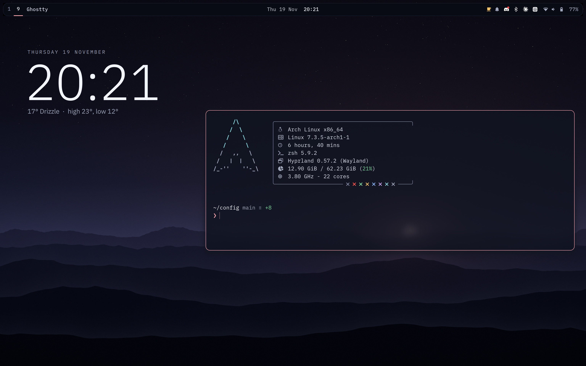
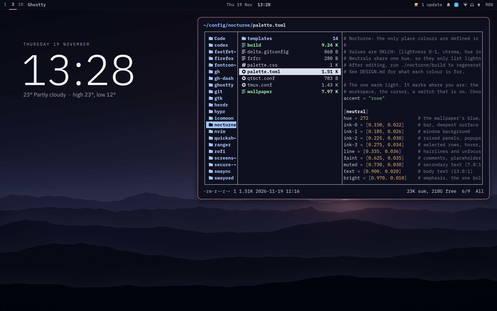
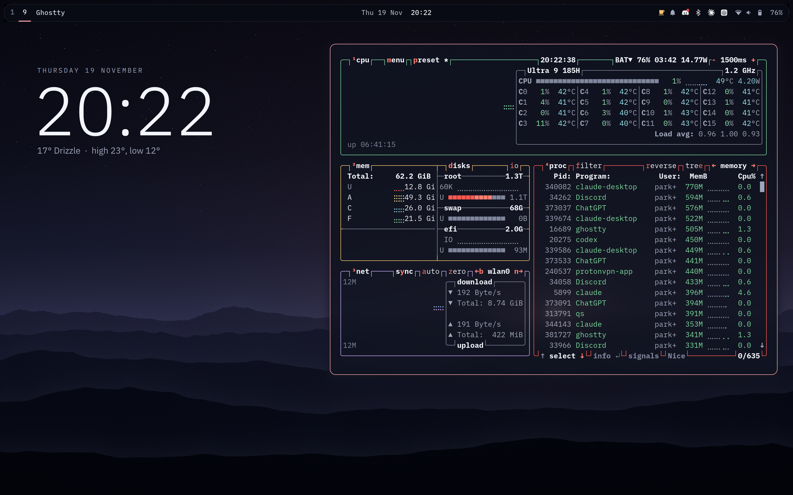

# Arch Linux and Hyprland dot files

Checkout the NixOS dotfiles for this config! At [AlvaroParker/NixOS-config](https://github.com/AlvaroParker/NixOS-config)

Everything here follows one design system, **Nocturne**: a cold, dark field
with a single warm light in it. See [DESIGN.md](./DESIGN.md) for the rules,
colours, type, spacing and motion, and for how to change the accent colour.

## Warning! The installation script `install` will overwrite your existing dot files! The script has only been tested on a freshly installed Arch Linux with GNOME. Use at your own risk!

## Installation:

It is recommended to first configure your fastest mirrors. You can use `rate-mirrors` AUR package:

```bash
git clone https://aur.archlinux.org/rate-mirrors-bin.git
cd rate-mirrors-bin && makepkg -si
```

Then, on `bash` execute the following command:

```bash
export TMPFILE="$(mktemp)"
sudo true
rate-mirrors --save=$TMPFILE arch --max-delay=43200 && sudo mv /etc/pacman.d/mirrorlist /etc/pacman.d/mirrorlist-backup && sudo mv $TMPFILE /etc/pacman.d/mirrorlist
```

Finally, run the dot files installation script. It will install all the needed dependencies using `paru` to install from the AUR.

```
./install
```

Personal details stay out of the repo: git identity in `~/.gitconfig`,
machine-specific shell settings in `~/.custom_zshrc`, the chosen wallpaper
in `~/.local/state/nocturne`, and the weather location in
`~/.config/nocturne-location.json` (`install` asks for your city).

## Everyday keys

| Key | Action |
| --- | --- |
| `SUPER + D` | Launcher. `Tab` moves between Apps, Windows, Clipboard, Wi-Fi and Power |
| `SUPER + V` | Clipboard history |
| `SUPER + SHIFT + E` | Power: lock, sleep, log out, restart, shut down, power profile |
| `SUPER + N` | Notifications and controls (Wi-Fi, Bluetooth, night light, do not disturb, keep awake, performance) |
| `SUPER + ALT + W` | Wallpapers |
| `SUPER + /` | Search every key binding |
| `SUPER + SHIFT + R` | Resize mode (shown in the bar). `H J K L` resize, `Esc` or `Enter` leave |
| `SUPER + SHIFT + N` | Night light on or off. It also follows a schedule in `hypr/hyprsunset.conf` |

## Utilities

The `genswap` script will generate a new swapfile located at `/swapfile` and will output the needed kernel parameters to add for hibernation. **Do not run if you already have swap configured.**

## Screenshots

An empty workspace: the date, the time and the weather, drawn by Quickshell.


Ghostty, floating in the top right, with fastfetch.



ranger, previewing the palette.



btop.



Zed, with this repository open.


Programs used:

- [`Ghostty`](https://ghostty.org) - Terminal
- [`Zed`](https://zed.dev) - Editor
- [`Zen`](https://zen-browser.app/) - Browser
- [`Waybar`](https://github.com/Alexays/Waybar) - Bar
- [`Quickshell`](https://quickshell.org) - Desktop clock, weather and now playing
- [`Rofi`](https://github.com/davatorium/rofi) - Launcher
- [`SwayNotificationCenter`](https://github.com/ErikReider/SwayNotificationCenter) - Notifications and control centre
- [`Fastfetch`](https://github.com/fastfetch-cli/fastfetch)
- `Tmux` - Terminal multiplexer
- `Zathura` - PDF viewer
