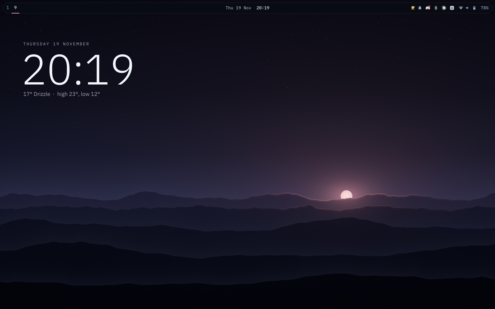
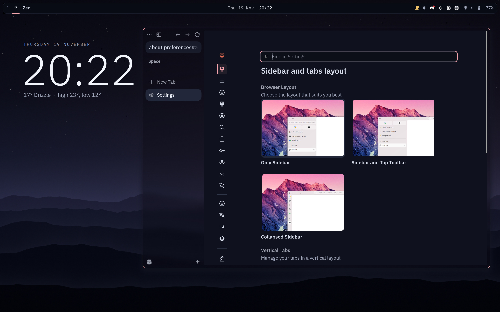

# Arch Linux and Hyprland dotfiles



These dotfiles follow **Nocturne**, a design system built around a cold, dark
palette with a single warm accent. See [DESIGN.md](./DESIGN.md) for the design
rules and how to change the accent colour.

The [NixOS version](https://github.com/AlvaroParker/NixOS-config) is also available.

## Screenshots

<p>
  <a href="./screenshots/2-terminal.jpg"></a>
  <a href="./screenshots/3-ranger.jpg"></a>
</p>
<p>
  <a href="./screenshots/4-btop.jpg"></a>
  <a href="./screenshots/5-zed.jpg"></a>
</p>
<p>
  <a href="./screenshots/6-zen.jpg"></a>
</p>

## Installation

**The `install` script will overwrite your existing dotfiles.** It has only been tested on a fresh Arch Linux installation with GNOME. Use at your own risk.

It is recommended to first configure your fastest mirrors. You can use `rate-mirrors` AUR package:

```bash
git clone https://aur.archlinux.org/rate-mirrors-bin.git
cd rate-mirrors-bin && makepkg -si
```

Then, on `bash` execute the following command:

```bash
export TMPFILE="$(mktemp)"
sudo true
rate-mirrors --save=$TMPFILE arch --max-delay=43200 && sudo mv /etc/pacman.d/mirrorlist /etc/pacman.d/mirrorlist-backup && sudo mv $TMPFILE /etc/pacman.d/mirrorlist
```

Finally, run the dot files installation script. It will install all the needed dependencies using `paru` to install from the AUR.

```
./install
```

Personal details stay out of the repo: git identity in `~/.gitconfig`,
machine-specific shell settings in `~/.custom_zshrc`, the chosen wallpaper
in `~/.local/state/nocturne`, and the weather location in
`~/.config/nocturne-location.json` (`install` asks for your city).

## Everyday keys

| Key | Action |
| --- | --- |
| `SUPER + D` | Launcher. `Tab` moves between Apps, Windows, Clipboard, Wi-Fi and Power |
| `SUPER + V` | Clipboard history |
| `SUPER + SHIFT + E` | Power: lock, sleep, log out, restart, shut down, power profile |
| `SUPER + N` | Notifications and controls (Wi-Fi, Bluetooth, night light, do not disturb, keep awake, performance) |
| `SUPER + ALT + W` | Wallpapers |
| `SUPER + /` | Search every key binding |
| `SUPER + SHIFT + R` | Resize mode (shown in the bar). `H J K L` resize, `Esc` or `Enter` leave |
| `SUPER + SHIFT + N` | Night light on or off. It also follows a schedule in `hypr/hyprsunset.conf` |

## Utilities

The `genswap` script will generate a new swapfile located at `/swapfile` and will output the needed kernel parameters to add for hibernation. **Do not run if you already have swap configured.**

## Programs used

- [`Ghostty`](https://ghostty.org) - Terminal
- [`Zed`](https://zed.dev) - Editor
- [`Zen`](https://zen-browser.app/) - Browser
- [`Waybar`](https://github.com/Alexays/Waybar) - Bar
- [`Quickshell`](https://quickshell.org) - Desktop clock, weather and now playing
- [`Rofi`](https://github.com/davatorium/rofi) - Launcher
- [`SwayNotificationCenter`](https://github.com/ErikReider/SwayNotificationCenter) - Notifications and control centre
- [`Fastfetch`](https://github.com/fastfetch-cli/fastfetch)
- `Tmux` - Terminal multiplexer
- `Zathura` - PDF viewer
