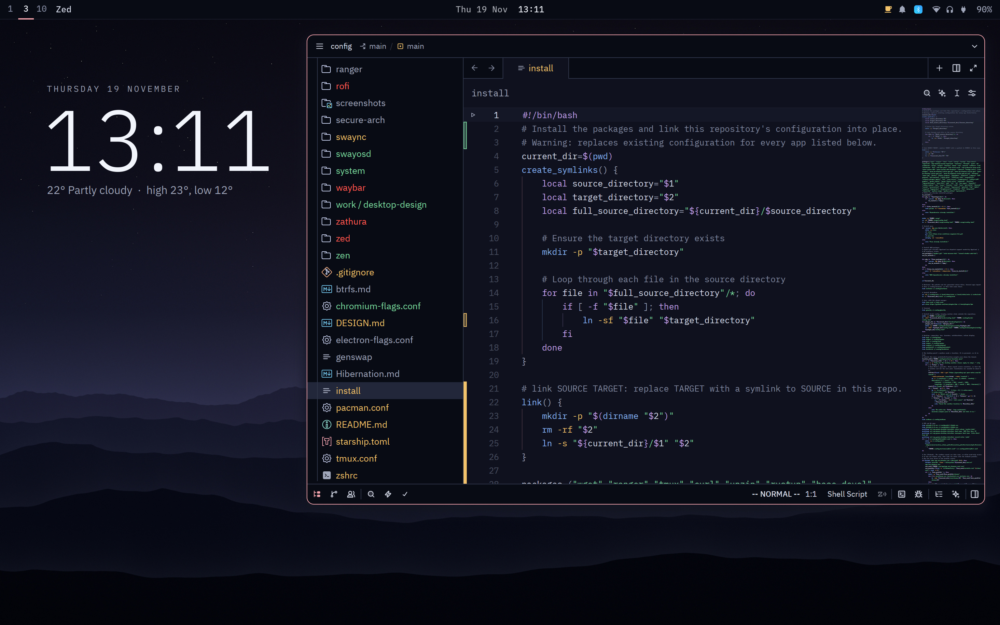

# Arch Linux and Hyprland dotfiles


These dotfiles follow **Nocturne**, a design system built around a cold, dark
palette with a single warm accent. See [DESIGN.md](./DESIGN.md) for the design
rules and how to change the accent colour.

The [NixOS version](https://github.com/AlvaroParker/NixOS-config) is also available.

## Screenshots

<p>
  <a href="./screenshots/2-terminal.jpg"></a>
  <a href="./screenshots/3-ranger.jpg"></a>
</p>
<p>
  <a href="./screenshots/4-btop.jpg"></a>
  <a href="./screenshots/5-zed.jpg"></a>
</p>
<p>
  <a href="./screenshots/6-zen.jpg"></a>
</p>

## Installation

To install Arch itself on this laptop, beside Windows, start with
[REINSTALL.md](./REINSTALL.md). It goes from the Arch ISO to the point where
the steps below take over.

**The `install` script will overwrite your existing dotfiles.** It has only been tested on a fresh Arch Linux installation with GNOME. Use at your own risk.

It is recommended to first configure your fastest mirrors. You can use `rate-mirrors`, from the official repositories:

```bash
sudo pacman -S rate-mirrors
```

Then, on `bash` execute the following command:

```bash
export TMPFILE="$(mktemp)"
sudo true
rate-mirrors --save=$TMPFILE arch --max-delay=43200 && sudo mv /etc/pacman.d/mirrorlist /etc/pacman.d/mirrorlist-backup && sudo mv $TMPFILE /etc/pacman.d/mirrorlist
```

Finally, run the dot files installation script. It will install all the needed dependencies using `paru` to install from the AUR.

```
./install
```

The cursor theme (Bibata Modern Classic) is not in the official repos. `install`
downloads one pinned release from the project's GitHub page and checks it
against a checksum kept in the script before unpacking it into
`~/.local/share/icons`. The icon theme (Reversal, in blue) has no releases,
so `install` fetches one pinned commit of its repository and runs the
project's own install script, which puts the icons in the same folder.

`install` also makes zsh the login shell, and enables NetworkManager, Docker,
Tailscale and TLP with its profiles daemon. Tailscale still needs a sign-in:
`sudo tailscale up`. If another network service is running
(iwd, dhcpcd or systemd-networkd), NetworkManager is enabled but not started;
disable the other one and restart.

Personal details stay out of the repo: git identity in `~/.gitconfig`,
machine-specific shell settings in `~/.custom_zshrc`, the chosen wallpaper
in `~/.local/state/nocturne`, and the weather location in
`~/.config/nocturne-location.json` (`install` asks for your city).

### Login screen

`install` sets up the login screen with `nocturne greeter install`, and
enables greetd when no other login manager is enabled, as on a fresh install.
If one is, such as GNOME's gdm, it is left alone and `install` says how to
switch:

```sh
nocturne greeter preview         # optional: look at it in a window first
sudo systemctl disable gdm       # or whichever login manager is enabled now
sudo systemctl enable greetd
```

Then restart the computer. Logging out is not enough the first time, because
greetd reads its config only when it starts.

The login screen runs from copies in `/etc`, so it does not follow the repo by
itself. After changing the accent or the wallpaper, run
`nocturne greeter install` again; `nocturne doctor` says when the copies are
out of date. If the screen ever fails to start, the text login takes over.
[system/README.md](./system/README.md) has the details and how to go back.

The lock screen takes a fingerprint as well as the password. The polkit
password window takes one too once its PAM file in `system/` is installed;
[system/README.md](./system/README.md#fingerprint) says how. The login screen
takes only the password, so it never waits for the sensor.

## Everyday keys

| Key | Action |
| --- | --- |
| `SUPER + D` | Launcher. `Tab` moves between Apps, Windows, Clipboard, Wi-Fi and Power |
| `SUPER + V` | Clipboard history |
| `SUPER + SHIFT + E` | Power: lock, sleep, log out, restart, shut down, power profile. Sleep turns into hibernation after two hours on battery |
| `SUPER + N` | Notifications and controls (Wi-Fi, Bluetooth, night light, do not disturb, keep awake, performance) |
| `SUPER + ALT + W` | Wallpapers |
| `SUPER + ALT + A` | Accent colour. Repaints the desktop, the terminal and the wallpaper's moon |
| `SUPER + /` | Search every key binding |
| `SUPER + SHIFT + R` | Resize mode (shown in the bar). `H J K L` resize, `Esc` or `Enter` leave |
| `SUPER + SHIFT + S` | Screenshot: pick a region, a window, this display or all displays. Saved in `~/Pictures/Screenshots` and copied. `SUPER + SHIFT + D` or `Print` takes this display straight away. Click the notification to show the file in Files. The same menu records a region, a window's area or this display, without sound, into `~/Videos/Recordings` |
| `SUPER + ALT + R` | Stop the screen recording (a gold dot in the bar while it runs; clicking it stops too), or pick one to start. Notifications wait until it ends. The file's path is copied |
| `SUPER + SHIFT + N` | Night light on or off. It also follows a schedule in `hypr/hyprsunset.conf` |
| `SUPER + 1` … `0` | Workspace 1 to 10 of the current group. Add `SHIFT` to move the window there |
| `SUPER + CTRL + 1` … `9` | Switch both screens to that workspace group: a clean set of ten workspaces, while the others wait. Add `SHIFT` to send the window to that group. Anything else that takes you to another group, such as clicking a notification, brings both screens along too, except an app grabbing the focus in the 3 seconds after you switch |
| `SUPER + CTRL + scroll` | The next or previous workspace group |
| Three fingers up / down | The next or previous workspace group. Three fingers sideways move between this group's workspaces, and past the last one open its next empty workspace |

## Utilities

The `nocturne` command looks after the design system. `nocturne accent ember`
switches the accent everywhere, `nocturne reload` makes running apps pick up a
palette change, and `nocturne doctor` checks links, fonts and colour files.
Run `nocturne` on its own for the full list.

The `install` script reads what to link from `links.txt` and what to install
from `packages/`. Graphics drivers come from `gpu-intel.txt` or
`gpu-amd.txt`, picked by the GPUs the machine has.

`SUPER + SHIFT + T` copies the text in a region of the screen, in English or
Spanish, or the contents of a QR code if the region holds one
(`hypr/scripts/screen-text`, using tesseract and zbar). It all runs locally.
`SUPER + /` lists every key binding.

The `genswap` script will generate a new swapfile located at `/swapfile` and will output the needed kernel parameters to add for hibernation. It works on ext4 and btrfs, and stops if `/swapfile` already exists. A reinstall makes the swap file by hand instead; see [REINSTALL.md](./REINSTALL.md), step 6.

## Programs used

- [`Ghostty`](https://ghostty.org) - Terminal
- [`Zed`](https://zed.dev) - Editor
- [`Zen`](https://zen-browser.app/) - Browser
- [`Quickshell`](https://quickshell.org) - The bar, the desktop clock, weather and now playing, and the login screen (inside [`labwc`](https://labwc.github.io), started by `greetd`)
- [`Rofi`](https://github.com/davatorium/rofi) - Launcher
- [`SwayNotificationCenter`](https://github.com/ErikReider/SwayNotificationCenter) - Notifications and control centre
- [`Fastfetch`](https://github.com/fastfetch-cli/fastfetch)
- `Tmux` - Terminal multiplexer
- `Zathura` - PDF viewer
